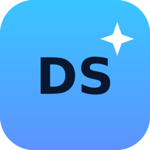

# DesignShop

**A friendly, Photoshop-class editor for thumbnails and social graphics.**
Primary language **English**, second language **فارسی** (full right-to-left UI).
Runs on **Windows**, **Linux** (including **Arch / Manjaro**) — with both an
**.exe installer** and a **portable** build.

<p align="center">
  
</p>

```
Layers · Text styles · Layer effects · Adjustments · Selection tools
Brush & eraser · Shapes & stickers · Thumbnail Studio · Assistant · Export
```

---

## Download

Every push to `main` publishes a fresh release in
[Releases](https://github.com/Manixpcshot/DesignShop/releases) with **source code**
and every installer:

| Platform | File | Notes |
| --- | --- | --- |
| Windows | `DesignShop-<ver>-windows-x64.exe` | NSIS installer (choose folder, shortcuts) |
| Windows | `DesignShop-<ver>-windows-portable-x64.exe` | **Portable** — no install, run anywhere |
| Windows | `DesignShop-<ver>-windows-portable.zip` | Unpacked portable folder |
| Debian / Ubuntu / Mint | `DesignShop-<ver>-linux-x64.deb` | `sudo apt install ./…deb` |
| Fedora / openSUSE / RHEL | `DesignShop-<ver>-linux-x64.rpm` | `sudo dnf install ./…rpm` |
| Any Linux | `DesignShop-<ver>-linux-x64.AppImage` | `chmod +x` and run |
| Portable Linux | `DesignShop-<ver>-linux-x64.tar.gz` | Unpack and run `./designshop` |
| **Arch / Manjaro** | `DesignShop-<ver>-arch.tar.gz` | Contains `PKGBUILD` + payload → `makepkg -si` |
| Rust core (Tauri) | `DesignShop-<ver>-tauri-linux-x64.*` | Smaller AppImage/deb/rpm from the Rust shell |
| Source | `source-<sha>.tar.gz` / `.zip` | Complete, buildable source |

### Arch / Manjaro

```bash
tar xf DesignShop-<ver>-arch.tar.gz
cd designshop-bin && makepkg -si     # or: sudo cp -R pkg/. /
designshop
```

---

## What is inside

DesignShop is built from **two desktop shells sharing one UI**:

| Shell | Where | Why |
| --- | --- | --- |
| **Electron** | `electron/` | Produces the `.exe`, **portable exe**, `deb`, `rpm`, `AppImage`, `tar.gz` and the Arch bundle. Ships everything a first-time user needs. |
| **Rust core (Tauri)** | `src-tauri/` | Native webview app with the file IO, autosave and clipboard work done in Rust. Produces small AppImage/deb/rpm bundles. |
| **UI** | `src/` | React + Canvas 2D editor shared by both shells and the browser preview. |

### Editor features

- **Canvas** — unlimited document sizes, zoom/pan, rulers, grid, rule-of-thirds, snapping, crop, rotate, flip, trim, resize.
- **Layers** — add, rename, drag to reorder, duplicate, merge down, flatten, lock, hide, opacity, 16 blend modes, transform (move/scale/rotate) with handles.
- **Selection** — rectangular marquee, lasso, magic wand (color tolerance), fill selection, erase selection.
- **Paint** — brush, highlighter, eraser with size control (`[` / `]`), eyedropper (right-click anywhere).
- **Text** — 13 bundled fonts (incl. **Vazirmatn** for فارسی), 18 one-click thumbnail styles (neon, comic, chrome, gold, fire, holo, sticker, meme…), gradients, curves, letter spacing, alignment.
- **Shapes & stickers** — rectangle, ellipse, triangle, star, heart, polygon, line, arrow, speech bubble, frame, progress bar, starburst, 96 emoji stickers.
- **Layer effects** — drop shadow, outer glow, stroke/border, rounded corners, plus quick presets.
- **Adjustments** — brightness, contrast, saturation, vibrance, hue, warmth, tint, exposure, highlights, shadows, B&W, sepia, invert, blur, sharpen, grain, pixelate, posterize, vignette, duotone, threshold — with **Auto enhance** and 14 one-click looks.
- **Thumbnail Studio** — platform sizes, 10 kits (background + headline style + accents in one click), backgrounds, add-ons (arrows, badges, highlight circles), social sizes.
- **Assistant** — a chat box (`Ctrl/⌘ K`) that understands plain English **and** فارسی and performs the actions ("make a neon YouTube thumbnail", "سیاه و سفید کن", "export png").
- **History** — 70 undo steps, clickable history panel.
- **Projects** — `.dshop` files keep every layer editable; auto-save every 30 s.
- **Export** — PNG / JPG / WEBP, scale 0.25×–4×, transparent background, copy to clipboard, and **export all social sizes at once**.
- **Themes** — Dark, Light, Midnight; accent color; full **RTL** layout for فارسی.
- **Works offline.** No account, no upload, no telemetry.

### Keyboard shortcuts (the ones that matter)

| Keys | Action |
| --- | --- |
| `V M L W C B E T U Y H Z` | move · marquee · lasso · wand · crop · brush · eraser · text · shapes · sticker · hand · zoom |
| `Ctrl/⌘ Z` / `Ctrl/⌘ ⇧ Z` | undo / redo |
| `Ctrl/⌘ S` · `Ctrl/⌘ ⇧ E` · `Ctrl/⌘ ⇧ S` | save · quick PNG · export dialog |
| `Ctrl/⌘ A` · `Esc` · `Delete` | select all layers · deselect · delete/erase |
| `Ctrl/⌘ 0` · `Ctrl/⌘ 1` · `Ctrl/⌘ +/−` | fit · 100% · zoom |
| `Space` + drag · `[` `]` | pan · brush size |
| `Ctrl/⌘ K` · `Ctrl/⌘ /` | assistant · shortcut sheet |

---

## Develop

```bash
git clone https://github.com/Manixpcshot/DesignShop.git
cd DesignShop
npm install

npm run dev            # browser preview (http://localhost:5173)
npm run electron:dev   # Electron shell with hot reload
npm run tauri:dev      # Rust shell (needs Rust + system webview)
```

### Test

```bash
npm test          # 52 engine tests: renderer, document model, store, wizard, i18n
npm run test:ssr  # renders every screen/panel/dialog to catch UI regressions
npm run test:all  # both
```

### Build

```bash
npm run build                     # web bundle -> dist/
npm run electron:build:win        # exe + portable exe
npm run electron:build:linux      # AppImage, deb, rpm, tar.gz
npx tauri build                   # Rust bundles (deb, rpm, AppImage)
```

### Icons must be RGBA

Tauri embeds the window/bundle icon at compile time and refuses anything that is
not **8-bit RGBA** (PNG colour type 6). A palette-coloured PNG passes every
"looks fine" check and then panics `generate_context!` during `cargo build`.
Keep the icon set converted:

```bash
for f in src-tauri/icons/*.png build/icons/*.png build/icon.png; do
  convert "$f" -define png:color-type=6 -depth 8 "PNG32:$f"
done
npm run check   # fails loudly if an icon ever regresses
```

### Versioning & releases

`npm run bump -- 1.0.7` (or `node scripts/bump-version.mjs 1.0.7`) syncs the
version across `package.json`, `tauri.conf.json`, `Cargo.toml` and the UI.
CI runs on every push: tests → builds → **publishes a release with every
artifact and the source archive**. Tags follow `v1.0.<build>`; `main` also
refreshes a rolling `latest` release.

---

## Project layout

```
src/                 UI (React 18 + Canvas 2D)
  lib/               engine: document model, renderer, filters, store, presets, i18n
  components/        shell, canvas stage, toolbars, panels, dialogs
electron/            Electron main + preload (portable / installer builds)
src-tauri/           Rust core (Tauri v2) — commands + config
packaging/arch/      Arch bundle generator (PKGBUILD + payload)
scripts/             icon generator, version bump, repo checks
tests/               headless canvas harness, engine tests, SSR tests
.github/workflows/   CI + release pipeline
```

## License

MIT — see [LICENSE](LICENSE).

**DesignShop** is an independent project. It is inspired by the workflow of
professional editors but shares no code with Adobe products.
